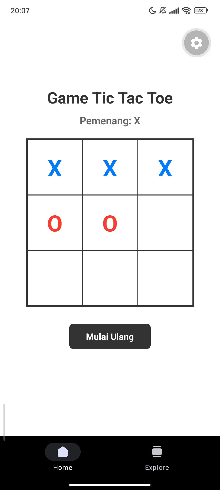

# ❌ O Tic Tac Toe App ⭕

Repositori ini berisi proyek pembuatan aplikasi game **Tic Tac Toe** interaktif. Aplikasi ini dikembangkan sebagai bagian dari tugas/proyek pembelajaran pemrograman perangkat lunak dengan fokus pada logika permainan, antarmuka pengguna (UI) yang responsif, serta penanganan *state* permainan secara 
real-time.

---

## 📱 Tentang Aplikasi
Tic Tac Toe adalah game klasik berbasis giliran (*turn-based*) di mana dua pemain (X dan O) berlomba untuk mendapatkan 3 tanda secara berurutan secara horizontal, vertikal, atau diagonal di dalam sebuah grid berukuran 3x3. Aplikasi ini dirancang agar mudah dimainkan, ringan, dan memiliki tampilan yang bersih.

---

## 📸 Screenshot Aplikasi
Berikut adalah tampilan antarmuka dari aplikasi Tic Tac Toe:

<p align="center">
  
</p>

---

## 📋 Prasyarat Pembuatan
Sebelum mulai merancang atau menjalankan aplikasi Tic Tac Toe ini, pastikan kamu telah menyiapkan beberapa hal berikut:
* **Perangkat Lunak / IDE:** Menggunakan *Android Studio*, *Visual Studio Code*, atau editor kode lain yang mendukung bahasa pilihanmu.
* **Bahasa Pemrograman:** Pemahaman dasar tentang logika pemrograman (seperti *Conditional Statements*, *Arrays/Grid Matrix*, dan *Event Handling*).
* **Git:** Terinstal di komputer untuk melakukan pengelolaan versi kode sumber.

---

## ✨ Fitur Utama
* **Pemain Ganda (2-Player Mode):** Mendukung permainan secara bergantian untuk dua orang dalam satu perangkat.
* **Deteksi Pemenang Otomatis:** Sistem secara otomatis mendeteksi kondisi kemenangan (baris, kolom, atau diagonal) maupun kondisi seri (*draw*).
* **Indikator Giliran:** Menampilkan informasi visual tentang pemain mana yang sedang mendapatkan giliran (X atau O).
* **Tombol Reset/Ulangi Permainan:** Memungkinkan pemain untuk memulai ulang papan permainan dengan cepat tanpa harus menutup aplikasi.
* **Antarmuka Responsif:** Desain tata letak yang ramah pengguna dan optimal di berbagai ukuran layar.

---

## 🛠️ Teknologi & Alat yang Digunakan
* **Bahasa Pemrograman / Framework:** *(Sesuaikan dengan yang kamu pakai, misal: Java / Kotlin / JavaScript / Flutter)*
* **Tools / IDE:** *(Contoh: Android Studio / Visual Studio Code)*
* **Pengelolaan Versi:** Git & GitHub

---

## 🚀 Cara Menjalankan Proyek
1. **Clone repositori ini ke komputer lokal kamu:**
   ```bash
   git clone [https://github.com/jannfth/TugasTicTacToeApp.git](https://github.com/jannfth/TugasTicTacToeApp.git)
